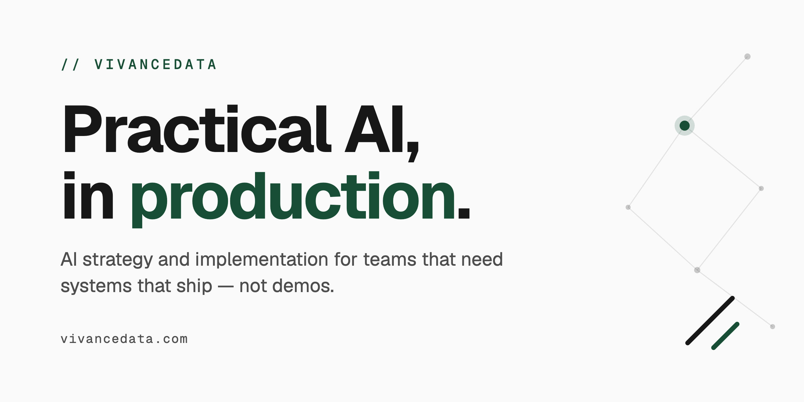

# VivanceData

**Small, specific software for trade and field businesses, built and run by one person.**

VivanceData is Lorenzo Scaturchio's one-person practice. I build the systems
that take the after-hours call and the twice-typed paperwork off a small
business, and I stay on to keep them running. The demo repos here run on
sample data only.

## What lives here

| Repository | What it is | Live |
|---|---|---|
| [`vivancedata`](https://github.com/Vivancedata/vivancedata) | The practice's site — Next.js on a token-driven design system | [vivancedata.com](https://www.vivancedata.com) |
| [`ui`](https://github.com/Vivancedata/ui) | **@vivancedata/ui** — the design system every surface speaks: one accent, an ink ladder, a spec-sheet voice | — |
| [`crm`](https://github.com/Vivancedata/crm) | Client relationship management for the practice | internal |
| [`learn`](https://github.com/Vivancedata/learn) | **Eureka** — a side project: learning paths for AI and data skills. Not part of the client work | [learn.vivancedata.com](https://learn.vivancedata.com) |

## How this org works

- **The product repos merge through pull requests with required status
  checks.** `main` on `vivancedata`, `learn`, `crm` and `ui` requires build,
  lint and type checks to pass, plus test suites with coverage floors on the
  three apps. The site's CI also scores pages against Lighthouse floors, and
  the site and `learn` run a daily deploy watchdog that fails loudly if merges
  stop reaching production. The small demo repos don't have CI yet.
- **One design language.** Colors, type scale, and spacing are tokens from
  [`ui`](https://github.com/Vivancedata/ui); the sites consume it as a
  versioned package. If a surface here looks like the website, that is on
  purpose.

## Get in touch

- **Website** — [vivancedata.com](https://www.vivancedata.com)
- **Email** — [lorenzo@vivancedata.com](mailto:lorenzo@vivancedata.com)
- **LinkedIn** — [Lorenzo Scaturchio](https://www.linkedin.com/in/lorenzo-scaturchio)
